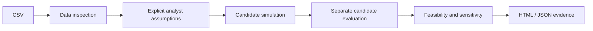

# Operations Decision Lab

**Help operations analysts compare hypothetical picking and packing allocations before committing a small team's capacity.**

**Business question:** Can any supported allocation satisfy the declared demand, service, budget and SLA constraints?

> [!IMPORTANT]
> **Decision supported**
> An operations analyst compares candidate staffing allocations and identifies what needs further investigation.
> If none passes the checks, the output is **NO CONFIRMED FEASIBLE OPTION**. A highest-ranked candidate is not automatically feasible, and a simulated result is not a validated staffing instruction.

**Status:** local synthetic research prototype. **External operational validation:** not established. **Deployment:** local use; public hosting requires a separate design.

[Source, installation and model reference](https://github.com/GarethMackenzie/operations-decision-lab)

## Reproduce the decision

After following the repository's Python 3.12 installation instructions:

```sh
python -m decision_lab demo --output reports/demo
python -m decision_lab replay reports/demo/report.json
python -m decision_lab serve
```

The demo exports HTML and JSON. Replay recomputes the numerical payload. The local workbench is available at `http://127.0.0.1:8765`.

At 18 arrivals/hour, 6 minutes picking and 7 minutes packing per order, two packers have nominal capacity of approximately 17.14 orders/hour. No allocation of four dedicated workers sustains demand under those assumptions. The correct response is to expose the constraint, not force a recommendation.

## See the result

| Capture | Required content | Caption |
|---|---|---|
| `docs/images/decision.png` | Assumptions, selected allocation and evaluation results from an actual run | “Synthetic scenario; conditional simulation results.” |
| `docs/images/no-feasible-option.png` | Default infeasible example and failed constraints | “No confirmed feasible option under the declared assumptions.” |
| `docs/images/sensitivity.png` | Fixed allocation evaluated under changed assumptions | “Sensitivity analysis; not a prediction interval.” |

<!-- Enable after capture:

-->



Observations do not silently become simulation inputs. CLI and browser use the same Python core. Reports contain submitted input: review them before sharing.

## Architectural decisions log

This summary reflects the existing architecture record and documented model behavior.

| Decision | Chosen approach | Alternative not adopted | Cost accepted | Revisit trigger |
|---|---|---|---|---|
| Interface | Flask/Waitress with plain browser assets | Streamlit or React | More explicit interface code; limited application scope | Multi-user requirements justify a new hosting ADR |
| Simulation | SimPy with an independent test reference | A custom production simulator | Third-party dependency and narrow model assumptions | Supported process requirements exceed the validated model |
| Candidate assessment | Separate selection and evaluation replications | Report only the best candidate's selection score | More simulation work; remaining model/input uncertainty | Measured runtime or evaluation requirements justify a revised experiment |

## Evidence and limitations

The repository documents hand calculations, boundary tests, conservation checks and an independent scheduling reference. Inspect those tests and release evidence before relying on a version. The current scope excludes shared workers, heterogeneous skills, overtime and multi-shift carryover. Report intervals concern replication means; they do not cover all input or model uncertainty.

## Next evidence milestone

Run a permitted, preregistered shadow-mode evaluation using event and roster data. Compare held-out observed outcomes with predictions and a simple baseline. Only a later approved intervention can establish operational effects.

## Engineering evidence

[Architecture and defensive programming](docs/engineering/ENGINEERING.md) · [External evaluation protocol](CASE_STUDY.md) · [Reusable README template](docs/engineering/README.template.md)

## Quick start — Python 3.12

From the repository root on Windows PowerShell:

```powershell
py -3.12 -m venv .venv
.\.venv\Scripts\python.exe -m pip install -r requirements.lock
.\.venv\Scripts\python.exe -m pip install --no-build-isolation --no-deps .
.\.venv\Scripts\python.exe -m decision_lab serve
```

On Linux/macOS:

```sh
python3.12 -m venv .venv
.venv/bin/python -m pip install -r requirements.lock
.venv/bin/python -m pip install --no-build-isolation --no-deps .
.venv/bin/python -m decision_lab serve
```

Open [the local workbench](http://127.0.0.1:8765). Load the synthetic sample → inspect data → review assumptions → tick the confirmation → compare → export HTML and JSON. The server binds only to loopback. Stop with Ctrl+C. `--port 8766` selects another local port.

CLI alternatives (use your environment's `python` path):

```sh
python -m decision_lab demo --output reports/demo
python -m decision_lab replay reports/demo/report.json
python -m decision_lab inspect src/decision_lab/samples/synthetic.csv --start 2026-01-05T08:00:00+00:00 --end 2026-01-05T16:00:00+00:00
```

`demo` writes `report.html` and `report.json`. Replay recomputes results and compares the input hash and numerical payload. It excludes environment metadata from equality because Python patch versions may differ. For a custom CLI run, save the `inputs` object from an exported report as `request.json`, edit its explicit assumptions, then run `python -m decision_lab run request.json --output reports/custom`.

## Data and interpretation

UTF-8 CSV, <=2 MB, <=5,000 orders. Required headers:

```csv
order_id,arrival_time,pick_start,pick_end,pack_start,pack_end
```

Optional `picker,packer`. One unique order per row; offset-aware ISO timestamps. Arrival means release to picking. Incomplete stages may be blank. Start/end intervals describe elapsed processing; **completion timestamps alone never become service durations**. Uploaded data is inspected descriptively. Manual simulation inputs remain separate; adopting observed means requires eligible complete records, worker IDs, no overlap and an explicit active-service attestation. An observation window controls exposure and censoring; future endpoints are not used as observed outcomes.

Every report includes the exact submitted CSV text (browser text areas normalize line endings), hash, window, full assumptions, all replication results and seeds, independent evaluation, sensitivity, model version and runtime versions. **Exports contain the original input; review before sharing.** The server holds uploads in memory and has no database, telemetry or upload persistence. Direct export links work for 10 minutes and are replaced by the next comparison; compare again if a link expires. The latest report stays in process memory until replaced or the server stops.

## Model scope

- Dedicated identical workers, FIFO, pick then pack; Poisson arrivals and independent lognormal services (CV=0 is deterministic).
- One 2–12 hour shift, a synchronized midpoint break that pauses work, and initial queues at either stage. No initial in-service work or inferred backlog age.
- All positive allocations within 2–6 workers. Nominal stability, chosen utilization ceiling, scheduled payroll budget and due-cohort SLA mean lower confidence bound must pass.
- 30 common-workload selection replications; 30 separate evaluation replications of one selected candidate. No reselection on evaluation results.
- Approximate 95% Student-t intervals for replication means. They exclude input/model uncertainty and are not prediction intervals. Missing due cohorts suppress SLA intervals.
- SLA cohort: new orders whose arrival + deadline <= shift end. Young arrivals are excluded; unfinished due orders count as failures. Completed-only cycle times may be optimistically biased.
- Payroll = all scheduled worker-hours × wage, including breaks/idle time. CU means the user's chosen currency unit. Marginal payroll is relative to baseline; no overtime, penalties, revenue or causal savings.
- Sensitivity holds selected staffing fixed and stresses arrivals, service means and variability. Supported input limits cap stress values, shown in exports.
- Warehouse Friction adds user-entered travel/congestion, replenishment, inventory-exception and packing-rework time as expected service-time additions, then runs a separate full staffing comparison. Manual-handling, traffic and aisle/storage flags are safety review prompts only. They are not industry benchmarks, a safety audit or performance prediction.
- Data inspection reports elapsed pick/pack interval counts, medians, 90th percentiles and sample CVs. Users may explicitly adopt the higher eligible stage CV as a conservative common model input after confirming that the intervals represent active service.

Unsupported: waves/batches, shared workers, skills, heterogeneous productivity, SKU/travel effects, seasonal demand, detailed calendars, overtime or multi-shift carryover. Nominal capacity is only a necessary workload screen. Public server deployment requires a separate security/hosting design.

## Architecture and research

`data.py` → `model.py` → `analysis.py` → `report.py`; `web.py` and CLI share this core. SimPy provides simulation, Flask the interface API, Waitress the local server; plain HTML/CSS/JS has no build pipeline.

- [Research dossier and competitor comparison](research/DOSSIER.md) · [Warehouse-friction research and sources](research/WAREHOUSE_ISSUES.md)
- [Dataset assessment](research/DATASETS.md) · [Risk register](research/RISKS.md)
- [Specification and release gates](docs/SPECIFICATION.md) · [Architecture decision](docs/ARCHITECTURE.md)
- [Verification evidence](evidence/VERIFICATION.md) · [Requirement traceability](docs/TRACEABILITY.md)
- [Third-party notices](THIRD_PARTY_NOTICES.md) · [Synthetic data documentation](src/decision_lab/samples/README.md)

## Development

Install `requirements-dev.lock`, then `python -m pip install --no-build-isolation --no-deps -e .`.

```sh
python -m pytest -q
python -m ruff check .
python -m ruff format --check .
python -m mypy
python -m bandit -q -r src
python -m pip_audit -r requirements-runtime.lock
python -m build --no-isolation
python scripts/benchmark.py
python scripts/secret_scan.py
```

Numerical tests include hand calculations, exact shift/break boundaries, conservation, resource capacity and an independent heap-based scheduling reference. Test results and release state are recorded in the evidence directory; upstream repositories were inspected, not treated as prevalidated integrations.

Next milestones: validate the problem with operations analysts; acquire a permitted semantically documented event/roster dataset and temporal holdout; run a monitored pilot before making intervention claims.

## License

MIT for original code and generated synthetic sample. See [LICENSE](LICENSE). Upstream research code and external operational datasets are not redistributed.
